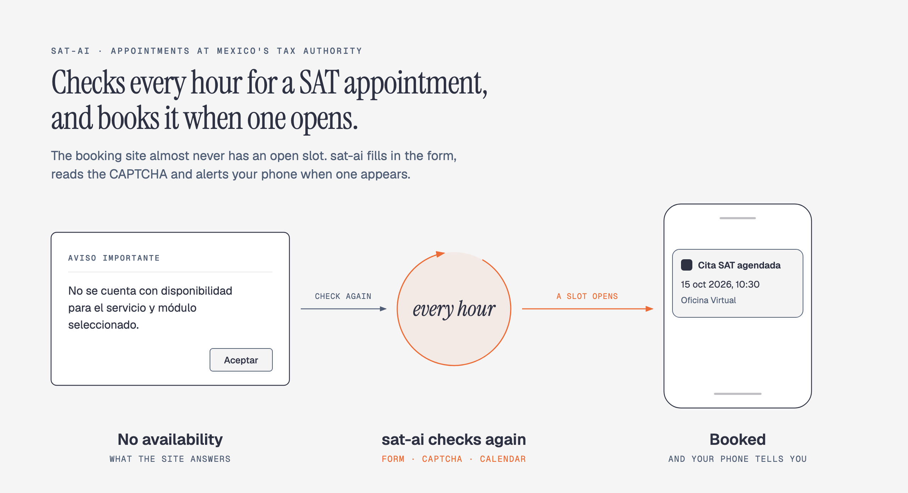
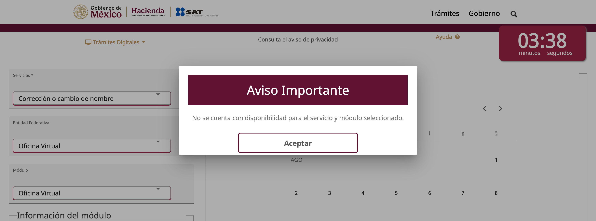
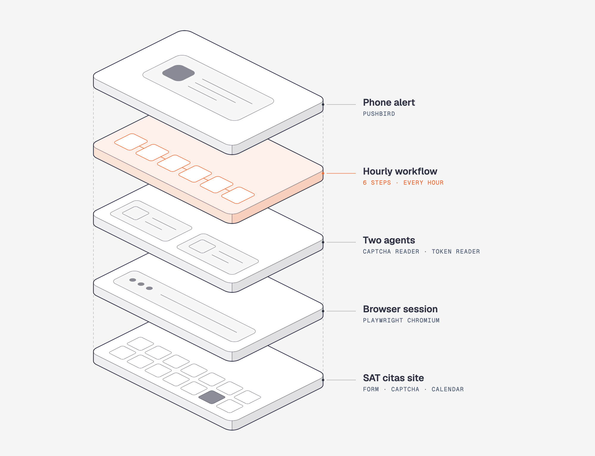

# sat-ai



Checks every hour for an open appointment at SAT, Mexico's federal tax authority, and books it or alerts your phone when one appears. Built with [Mastra](https://mastra.ai).

## The problem

Many procedures at SAT (Mexico's equivalent of the IRS) require an appointment, a *cita*, booked on `citas.sat.gob.mx`. There are almost never any to book. You type your tax ID, solve a CAPTCHA, pick a service and an office, and get this:



"There is no availability for the selected service and office." The site does not say when to come back, so the only way to get a slot is to repeat the check at all hours and hope to be looking when one opens.

I am a US and Mexican citizen, and I needed a cita to remove my mother's last name from my Mexican tax record so it matches my US documents. After a month of checking by hand without finding one, I automated the search.

## The solution

sat-ai repeats that check for you, every hour, day and night. When a slot opens it sends a push notification to your phone and, if you turn on `autoBook`, books the earliest date and time before the site's 5-minute session runs out.

It does not create slots or skip a queue. It books one appointment, for you, with your own data, the way you would by hand.

## How it works

Each check does what a person would do on the site, in the same order. Each row below is one step of the `checkAvailabilityWorkflow` workflow:

| By hand | Workflow step | How it is done |
| --- | --- | --- |
| Open the site and type your RFC, CURP and email | `fill-form` | A real Chromium browser driven by Playwright |
| Read the CAPTCHA and type it | `solve-captcha` | The image goes to `captchaAgent`, a vision model. Up to 4 attempts |
| Pick the service, state and office, and read the answer | `select-service` | Playwright. On the "no availability" dialog the browser is closed and the remaining steps do nothing |
| Notice that a slot is open | `notify-availability` | A push notification through PushBird |
| Pick a date and time, click "Generar cita", type the token SAT emails you | `book-appointment` | Only with `autoBook`. The email is read from Gmail through [Composio](#composio-gmail-access), and `emailTokenAgent` extracts the token |
| Find out whether the booking worked | `notify-booking` | A second push notification with the result, including the date and time |



The clicking and typing is ordinary code. AI models are used for only two jobs: reading the CAPTCHA image and finding the token in the email.

Without `autoBook`, the browser is left open on the calendar so you can finish the booking by hand. With `autoBook`, the workflow creates a real appointment, which uses up a slot. Scheduled runs have `autoBook` on.

The diagram shows the same six steps with what each one calls. All of them share one browser session, and everything after the CAPTCHA has to finish before the site's five-minute timer runs out.


### Stack

| Piece | Role |
| --- | --- |
| [Mastra](https://mastra.ai) | The workflow, the agents, the hourly schedule, and Studio, the local UI for running and inspecting them |
| Playwright | Drives the browser |
| DeepSeek | The models behind the agents: a vision model for the CAPTCHA, a text model for the email token |
| [Composio](https://composio.dev) | Read-only access to Gmail |
| PushBird | Push notifications |
| LibSQL and DuckDB | Local storage for runs and traces |

### Terms

The site is in Spanish, and so are the labels the workflow looks for.

| Term | Meaning |
| --- | --- |
| SAT | Servicio de Administración Tributaria, Mexico's federal tax authority |
| Cita | Appointment |
| RFC | Your Mexican tax ID (12 or 13 characters) |
| CURP | Mexico's national identity number (18 characters) |
| Entidad federativa | One of Mexico's states, or Mexico City |
| Módulo | The SAT office where the appointment takes place |
| Oficina Virtual | SAT's online office, for appointments held remotely |
| "Generar cita" | The "Create appointment" button |

## Setup

Requires Node.js 22.13 or later.

```shell
npm install
npx playwright install chromium
cp .env.example .env
```

Fill in `.env`:

| Variable | Used for |
| --- | --- |
| `DEEPSEEK_API_KEY` | The captcha agent and the email token agent |
| `PUSHBIRD_WEBHOOK_URL` | Push notifications. The URL embeds the secret, so treat it like a password |
| `COMPOSIO_API_KEY` | Reading the SAT token email when booking. Only needed with `autoBook`. See [Composio](#composio-gmail-access) |
| `COMPOSIO_USER_ID` | Optional. The Composio user id the Gmail account is connected under. Looked up automatically when empty |
| `CORE_URL` | SAT citas start page (has a default) |
| `RFC`, `CURP`, `EMAIL`, `SERVICE_1`, `PREFERRED_MODULE` | Your data for the [hourly schedule](#schedule). The schedule only exists when `RFC` and `EMAIL` are set |

## Composio (Gmail access)

Booking needs the security token that SAT emails after "Generar cita" is clicked. The workflow reads that email from Gmail through [Composio](https://composio.dev), so it never handles Gmail credentials itself. This is only used when `autoBook` is on; availability checks work without it.

To set it up:

1. Create a Composio project and an API key, and put the key in `COMPOSIO_API_KEY`.
2. In that project, connect the Gmail account that receives mail for the `email` you give the workflow (`EMAIL` for scheduled runs). SAT sends the token to that address.
3. If the project has more than one Gmail account connected, set `COMPOSIO_USER_ID` to the user id that account is connected under. When it is empty, the first active Gmail connection in the project is used.

How the token is read:

- Access is read-only. The only Composio tool called is `GMAIL_FETCH_EMAILS`, with the query `newer_than:1d`, up to 10 messages, spam and trash included (an automated government email can land there). The Gmail toolkit version is pinned (`GMAIL_TOOLKIT_VERSION` in `composio-gmail.ts`), so a new release cannot change the response under an unattended run.
- Before a slot is picked, one email is fetched to prove Gmail is readable. If that fails, nothing is reserved and the run ends with `booking: failed` and "Gmail is not readable through Composio: …".
- Only emails that arrived after "Generar cita" was clicked are considered, and only if the sender is `sat.gob.mx` or the email mentions "token".
- The sender, subject and first 4,000 characters of each of those emails are sent to `emailTokenAgent` (DeepSeek), which replies with the token. An unrelated email that mentions "token" and arrives in that window is sent too.
- A token is typed in only if it is 3 to 7 letters or digits and appears literally in the email.
- Gmail is checked every 5 seconds for up to 150 seconds, and at most 3 tokens are tried, which is the site's limit.

A missing or wrong `COMPOSIO_API_KEY`, or a project with no Gmail account connected, is caught by that first check. Errors after "Generar cita" (Composio or the token agent) do not stop the run, they are retried until the 150 seconds are up; if the last try still failed, `booking: failed` carries "The token could not be read from Gmail: …" instead of "The token email did not arrive in time". The browser stays open, so you can type the token by hand if the session is still alive.

## Run

```shell
npm run dev
```

Open [http://localhost:4111](http://localhost:4111) (Mastra Studio), choose the `checkAvailabilityWorkflow` workflow and run it with:

- `rfc`, `email`, and optionally `curp`
- `service` — the label in the "Servicios" dropdown, for example `Corrección o cambio de nombre` (accents and case are ignored)
- `entity` and `module` — both default to `Oficina Virtual`
- `autoBook` — book automatically when there is availability (default off for manual runs)

The result includes `availability` (`available`, `unavailable` or `not-checked`), `notified`, and `booking` (`booked`, `failed` or `skipped`) with the appointment date and time.

## Schedule

When `RFC` and `EMAIL` are set in `.env`, the workflow also runs by itself every hour, day and night (24 times a day), for as long as the server is running. Each scheduled run first waits a random 0 to 20 minutes, so checks are not exactly an hour apart. It uses `RFC`, `CURP`, `EMAIL`, `SERVICE_1` and `PREFERRED_MODULE` from `.env`.

Pause or resume it in Studio under `/workflows/schedules`. Runs you start by hand begin immediately unless you set `maxDelayMinutes`.

## Debugging

When a step fails, a full-page screenshot and the page HTML are saved to `debug-captures/`, and the path is added to the step's error. A booking attempt also saves captures at each stage (slot selected, token dialog, confirmation). These files show your RFC, CURP and email. The folder is gitignored and nothing is written when `NODE_ENV` is `production`.

## Project layout

```
src/mastra/
├── index.ts                               registers agents and workflows
├── agents/
│   ├── captcha-agent.ts                   reads the CAPTCHA image
│   └── email-token-agent.ts               extracts the token from the SAT email
├── utils/
│   ├── composio-gmail.ts                  reads Gmail through Composio
│   └── pushbird.ts                        PushBird client
└── workflows/
    ├── check-availability.workflow.ts
    └── cita-sat/                          steps, shared schemas and browser session
```

Local storage (`mastra.db`, DuckDB) is created on first run. To use Turso instead, set `TURSO_DATABASE_URL` and `TURSO_AUTH_TOKEN`.
